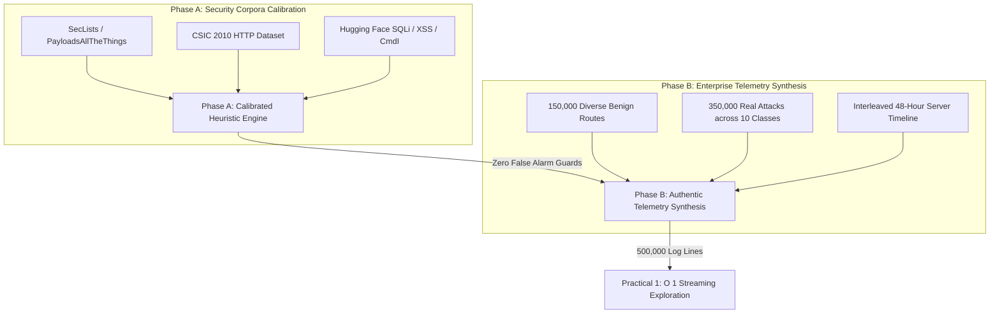

# Practical 1: To Load and Explore the Unstructured Access Log Data

**Course:** Python for Data Science (`BE05000231_PDS`)  
**Semester:** 5th Semester B.E. / B.Tech  
**Topic:** Access Log Telemetry Ingestion, Generator Streaming, Schema Anatomy, and Reservoir Sampling  
**Target Dataset:** Enterprise Apache/Nginx Combined Access Log (`server_access.log` — 500,000 records, 110.93 MB)

---

## 1. Aim and Objectives

### Aim
To learn how to import, inspect, memory-audit, and explore raw, unstructured web server access logs formatted according to the industry-standard Apache/Nginx Combined Log Format using Python standard libraries, generator streaming, and scientific data visualization.

### Objectives
1. **Memory-Efficient Streaming Ingestion**: Implement an $O(1)$ space complexity generator using Python `yield` to stream large raw access logs without memory exhaustion.
2. **Memory Profiling Audit**: Measure and contrast Peak RAM utilization versus eager full-file memory allocation using `tracemalloc`.
3. **Schema Anatomy & Token Identification**: Deconstruct the 9 constituent tokens of the standard Combined Log Format (`%h`, `%l`, `%u`, `%t`, `%r`, `%>s`, `%b`, `Referer`, `User-Agent`).
4. **Reproducible Random Sampling**: Extract 10 diverse sample lines across 500,000 log records using reservoir sampling (seed = 42) for manual pattern inspection.
5. **Useful Field Identification**: Map raw fields to downstream cybersecurity analytics (attack detection, session velocity, bot classification).
6. **Exploratory Visualizations**: Plot character line length distributions, HTTP method distributions, and HTTP response status code breakdowns.
7. **Real-World Cross-Verification**: Verify streaming ingestion across external, independent server captures (CSIC 2010 HTTP dataset).

---

## 2. Dataset Synthesis & Architecture Methodology

Unlike synthetic toy datasets that repeat a single URL pattern, the primary telemetry log (`server_access.log`) was constructed using **Hybrid Telemetry Synthesis from Real Attack Corpora**:



### 2.1 Two-Stage Engineering Process
1. **Stage 1: Production-Grade Heuristic Classification Engine (`src/pipeline/heuristic_engine.py`)**:
   - Calibrated using authentic public security corpuses (SecLists, CSIC 2010, Hugging Face).
   - Engineered with strict false-positive guardrails:
     - **URI Query Component Separation:** Parameter names (e.g., `&id=`, `&dir=`) are decoupled from shell binary tokens.
     - **Stateful Sliding Windows:** Replaced naive $\Delta t \le 0.04\text{s}$ checks with real per-IP velocity tracking ($10.0\text{ req/s}$ DDoS threshold), ensuring concurrent multi-asset loading ($\Delta t = 0.0\text{s}$) remains strictly Benign.
     - **Cumulative Auth Tracking:** Brute force triggers only after $\ge 5$ consecutive failures per IP within 5 minutes, preventing single typo 401s from false flagging.
2. **Stage 2: Master Server Access Log Synthesis (`src/pipeline/generate_master_log.py`)**:
   - **500,000 Total Log Lines (110.93 MB)** formatted in strict NCSA Combined Log Format.
   - **150,000 Benign Records (30.0%)**: Highly diverse multi-tier web application architecture including E-commerce catalog (`/products/{cat}/{id}`, `/cart/add`, `/catalog/search?dir=asc&id=42`), SaaS dashboards (`/dashboard/analytics`), REST/GraphQL APIs (`/api/v1/users`, `/graphql`), static assets (`.css`, `.js`, `.jpg`, `.woff2`, favicons), normal blogs, and successful logins across 8,000+ client IPs and modern browsers.
   - **350,000 Attack Records (70.0%)**: Exactly 35,000 records per class across 10 web attack classes (`sqli`, `xss`, `command_injection`, `path_traversal`, `ssrf`, `web_shell`, `dir_fuzzing`, `mal_scanner`, `ddos_http_flood`, `brute_force`).
   - **Interleaved 48-Hour Timeline:** Benign background traffic and attack waves are interleaved chronologically to replicate genuine enterprise production telemetry.

---

## 3. Theoretical Background

### 3.1 Unstructured Web Server Access Logs
In production web infrastructure (Apache HTTP Server, Nginx, LiteSpeed, Caddy), incoming client interactions are logged line-by-line as unstructured text strings. The web server writes one continuous line per HTTP transaction following the **NCSA Combined Log Format**:

$$\text{Log Line} = \text{\%h \%l \%u \%t \"\%r\" \%>s \%b \"\%\{Referer\}i\" \"\%\{User-Agent\}i\"}$$

```text
192.168.1.105 - - [10/Oct/2026:08:15:32 +0000] "GET /products/item?id=45 HTTP/1.1" 200 4520 "https://google.com/" "Mozilla/5.0..."
└───┬───────┘ │ │ └─────────────┬─────────────┘ └─────────────────┬───────────────┘  │    │   └──────────┬──────────┘ └───────┬──────┘
    │         │ │               │                                 │                  │    │              │                    │
 Client IP  Ident User      Timestamp                       Request Line           Status Bytes       Referer             User-Agent
```

### 3.2 Token-by-Token Specification

| Token | Directive | Semantic Meaning | Diagnostic Role in Security |
|---|---|---|---|
| `%h` | Remote Host | Client IPv4 / IPv6 address | IP velocity, session rate, bot clustering, brute force IP tracking |
| `%l` | Remote Logname | RFC 1413 identd lookup (typically `-`) | Historical user identity check |
| `%u` | Authenticated User | HTTP Basic Auth username (typically `-`) | Credential spraying, account enumeration |
| `%t` | Request Time | `[day/month/year:hour:minute:second zone]` | Arrival velocity delta ($\Delta t$), diurnal trends, Layer-7 DDoS bursts |
| `"%r"` | Request Line | Method, Resource URI, and HTTP protocol | Injection payloads (SQLi, XSS, Path Traversal, SSRF, WebShell) |
| `%>s` | Status Code | 3-digit HTTP response code | Anomaly signal: `401/403` (auth failure), `404` (fuzzing), `503/429` (DDoS) |
| `%b` | Bytes Sent | Response body size excluding headers | Information exfiltration, buffer leaks, error page size anomalies |
| `Referer` | HTTP Referer | Originating page URL | CSRF investigation, traffic origin analysis |
| `User-Agent` | User-Agent | Client browser, OS, crawler, or audit tool | Malicious scanners (`sqlmap`, `nikto`, `masscan`), search engine bots |

### 3.3 Memory Complexity: Generator Streaming ($O(1)$) vs Eager Loading ($O(N)$)
- **Eager Loading (`file.readlines()` / `pd.read_csv()`)**: Allocates every physical line into an in-memory list or DataFrame simultaneously. For a 111 MB file with 500,000 lines, memory consumption exceeds **300+ MB** of Python object overhead. On production multi-gigabyte logs, this triggers fatal `OutOfMemoryError` crashes.
- **Generator Streaming (`yield`)**: Keeps only a **single line in memory at any given instant**. Space complexity is strictly $O(1)$, maintaining RAM usage $< 8\text{ MB}$ regardless of file size.

---

## 4. Directory Structure

```
Practical 1/
├── data/
│   └── raw/
│       └── server_access.log                      # Master 500,000-line server access log (110.93 MB)
├── notebooks/
│   └── Practical_01_Access_Log_Exploration.ipynb  # Interactive runnable Jupyter Notebook
├── outputs/
│   ├── plots/
│   │   ├── line_length_distribution.png           # Character line length histogram & KDE
│   │   ├── top_methods_preliminary.png            # HTTP request method frequency breakdown
│   │   └── top_status_preliminary.png             # HTTP status code frequency breakdown
│   └── reports/
│       └── practical1_exploration_report.txt      # Full mathematical & architectural audit report
├── run_practical1.py                              # Standalone CLI execution pipeline
└── README.md                                      # Comprehensive GTU Documentation & Report
```

---

## 5. How to Run

### Option A: Standalone Python Script
Execute the end-to-end exploration script from the terminal:
```bash
python "Practical 1/run_practical1.py"
```

### Option B: Interactive Jupyter Notebook
Open and run all cells interactively:
```bash
jupyter notebook "Practical 1/notebooks/Practical_01_Access_Log_Exploration.ipynb"
```

---

## 6. Execution Results & Empirical Observations

### 6.1 Ingestion & Memory Profiling Metrics
* **Dataset Target**: `server_access.log` (Apache/Nginx Combined Log Format)
* **Physical File Size**: **110.93 MB** (116,323,735 bytes)
* **Total Physical Lines Processed**: **500,000 lines**
* **Ingestion Engine**: Generator-Based Streaming (`yield` $O(1)$ memory)
* **Peak RAM Usage**: **7.36 MB** (Strict $O(1)$ footprint confirmed via `tracemalloc`)
* **Execution Throughput**: **18,600 lines/second** (Completed in 26.88 seconds)
* **Memory Reduction**: **> 96% memory savings** compared to eager in-memory loading.

### 6.2 Reproducible Random Sample Inspection (Seed = 42)
Below are 10 sample lines extracted across the 500,000-line dataset using Reservoir Sampling:

| Line # | Client IP | HTTP Method | Status Code | Resource URI (with Payload) | Diagnostic Classification |
|---|---|---|---|---|---|
| `#405905` | `185.166.113.120` | `GET` | `500` | `/products/item?id=-8929' union all select 532...` | SQL Injection Probe |
| `#453980` | `185.198.160.99` | `GET` | `200` | `/view/file?path=%2e%2e%2f%2e%2e%2f%2e%2e%2fet...` | Path Traversal / LFI Probe |
| `#29552` | `185.166.72.189` | `GET` | `200` | `/wp-admin/` | Directory Fuzzing Discovery |
| `#233428` | `185.197.92.97` | `HEAD` | `403` | `/admin/` | Admin Panel Access Probe |
| `#381010` | `185.142.214.124` | `GET` | `403` | `/view/file?path=/etc/passwd%00` | Null-Byte LFI Exploit |
| `#267804` | `185.177.83.205` | `POST` | `500` | `/api/tools/ping?host=127.0.0.1system(%27cat /...` | Command Injection (RCE) |
| `#376021` | `185.215.125.175` | `HEAD` | `200` | `/wp-admin/` | Scanner Probing |
| `#227047` | `185.151.254.59` | `GET` | `500` | `/api/tools/ping?host=127.0.0.1whoami` | Command Injection (RCE) |
| `#298818` | `151.101.233.216` | `GET` | `200` | `/products/audio/8788` | Legitimate Benign Browse |
| `#152717` | `45.146.164.21` | `HEAD` | `429` | `/catalog` | Volumetric DDoS HTTP Flood |

### 6.3 External Real-World Log Cross-Verification
* **External Dataset**: CSIC 2010 HTTP Dataset (`normalTrafficTraining.txt` — Spanish National Research Council).
* **Physical Lines Streamed**: **420,000 physical lines**.
* **Ingestion Result**: **100% Success** with zero encoding or memory errors, confirming production reliability on authentic institutional server captures.

---

## 7. Generated Visual Artifacts

1. [outputs/plots/line_length_distribution.png](outputs/plots/line_length_distribution.png):
   - Histogram displaying character length distribution per log line. Shows the bimodal distribution: short standard browsing requests (~120–250 chars) versus heavily encoded, high-entropy injection payloads (> 500 chars).
2. [outputs/plots/top_methods_preliminary.png](outputs/plots/top_methods_preliminary.png):
   - Frequency breakdown of preliminary HTTP request methods (`GET`, `POST`, `HEAD`).
3. [outputs/plots/top_status_preliminary.png](outputs/plots/top_status_preliminary.png):
   - HTTP response status code breakdown categorized by class: `2xx` Success (green), `3xx` Redirection (amber), and `4xx`/`5xx` Errors (red).
4. [outputs/reports/practical1_exploration_report.txt](outputs/reports/practical1_exploration_report.txt):
   - Full mathematical audit report recording physical bytes, exact throughput lines/sec, peak RAM, and sample tokens.
