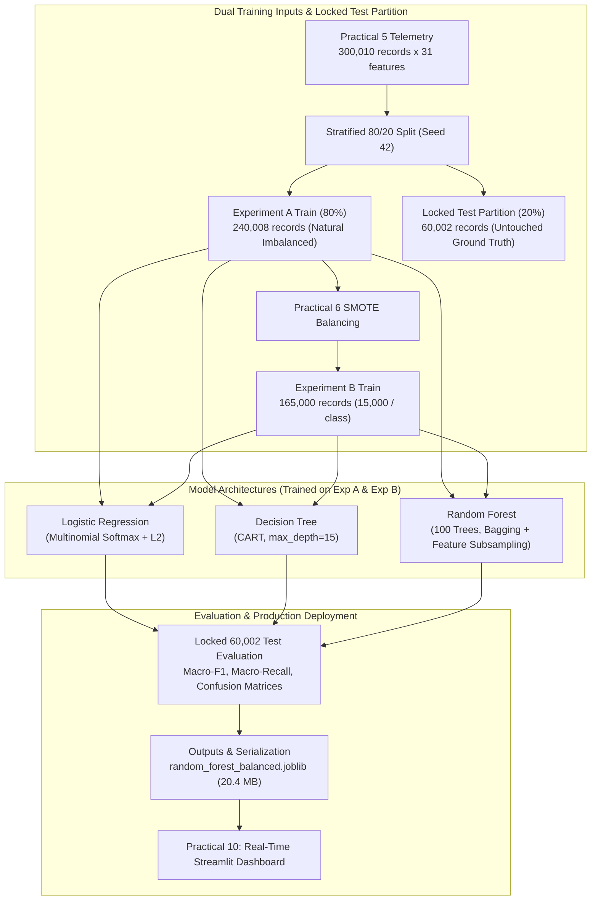

# Practical 9: Attack Classification Using Simple and Ensemble Classifiers

**Course:** Python for Data Science (`BE05000231_PDS`)  
**Semester:** 5th Semester B.E. / B.Tech  
**Project Aim:** *"To build a Simple Classifier to detect the attacks."*  
**Pipeline Ingestion:**  
- **Locked Test Partition:** Practical 6 untouched test set ([`test_dataset.parquet`](file:///c:/Users/Asus%20f15/PDS-Practicals/Practical%206/data/processed/test_dataset.parquet) — 60,002 records $\times$ 55 columns)  
- **Experiment B (SMOTE-Balanced Training):** Practical 6 balanced training partition ([`balanced_training_dataset.parquet`](file:///c:/Users/Asus%20f15/PDS-Practicals/Practical%206/data/processed/balanced_training_dataset.parquet) — 165,000 records: exactly 15,000 per class across 11 classes)  
- **Experiment A (Natural Imbalanced Training):** Practical 5 engineered telemetry 80% natural split ([`featured_logs.parquet`](file:///c:/Users/Asus%20f15/PDS-Practicals/Practical%205/data/processed/featured_logs.parquet) — 240,008 records: 68.7% benign majority)  
**Pipeline Hand-off:** Serializes trained model weights ([`random_forest_balanced.joblib`](file:///c:/Users/Asus%20f15/PDS-Practicals/Practical%209/outputs/models/random_forest_balanced.joblib)) for real-time inference and deployment in **Practical 10 (Real-Time Threat Detection Dashboard)**.

---

## 1. Aim and Objectives

### Aim
To design, train, evaluate, and benchmark simple linear (Logistic Regression), single-tree (Decision Tree), and ensemble (Random Forest) supervised machine learning classifiers to detect and classify multi-class web application cyberattacks across **BOTH** training paradigms (Natural Imbalanced vs. SMOTE-Balanced), validating the models strictly against an untouched, locked real-world test partition.

### Objectives
1. **Pipeline Continuity & Zero-Leakage Architecture:** Ingest the 31-dimensional feature vector (30 canonical behavioral features from Practical 5 + Isolation Forest anomaly score) and evaluate strictly on the locked 60,002 test records partitioned in Practical 6.
2. **Dual Experimental Design:**
   - **Experiment A (Natural Imbalanced Training):** Train on 240,008 raw records reflecting natural server distribution (164,960 benign vs. scarce minority attacks).
   - **Experiment B (SMOTE-Balanced Training):** Train on 165,000 equalized records synthesized via SMOTE + Tomek Links (15,000 records per class across all 11 classes).
3. **Multi-Model Comparison:**
   - **Logistic Regression:** Linear decision surface with multinomial softmax and L2 regularization.
   - **Decision Tree (CART):** Non-linear axis-aligned splits minimizing Gini impurity (`max_depth=15`).
   - **Random Forest Ensemble:** Bagged forest of 100 decorrelated trees with random feature subsampling ($\sqrt{d}$).
4. **Rigorous Multi-Class Evaluation:** Quantify performance using macro-averaged metrics (Accuracy, Balanced Accuracy, Macro Precision, Macro Recall, Macro F1, Inference Latency) and granular per-class breakdown tables.
5. **Explainability & Feature Attribution:** Compute Mean Decrease in Impurity (Gini importance) to identify the top discriminative cybersecurity signals.
6. **Artifact Persistence:** Serialize production weights (`random_forest_balanced.joblib`, `random_forest.joblib`, `logistic_regression.joblib`, `decision_tree.joblib`) for downstream real-time inference.

---

## 2. Theoretical Architecture & Mathematical Foundations



### 2.1 Logistic Regression (Linear Multinomial Baseline)
For an input vector $\mathbf{x} \in \mathbb{R}^{d}$ and $K=11$ attack classes, multinomial logistic regression computes the posterior class probability via the softmax function:

$$P(Y = k \mid \mathbf{x}) = \frac{\exp(\mathbf{w}_k^T \mathbf{x} + b_k)}{\sum_{j=1}^K \exp(\mathbf{w}_j^T \mathbf{x} + b_j)}$$

Optimization minimizes the cross-entropy loss augmented by $L_2$ Tikhonov regularization:

$$\mathcal{L}_{\text{multinomial}}(\mathbf{W}) = -\frac{1}{N}\sum_{i=1}^N \sum_{k=1}^K \mathbb{I}(y_i = k) \ln P(Y = k \mid \mathbf{x}_i) + \frac{\lambda}{2} \sum_{k=1}^K \|\mathbf{w}_k\|_2^2$$

Because logistic regression constructs planar hyperplanes, it establishes the linear separability benchmark.

### 2.2 Decision Tree Classifier (CART)
The Classification and Regression Tree (CART) recursively bisects the feature space $\mathcal{X}$ into hyper-rectangles $R_m$. At each node, the split $(j, t)$ across feature $j$ and threshold $t$ is chosen to maximize Gini impurity decrease $\Delta I(s)$:

$$I_G(m) = 1 - \sum_{k=1}^K p_{mk}^2, \quad \Delta I(s) = I_G(m) - \frac{N_L}{N_m} I_G(m_L) - \frac{N_R}{N_m} I_G(m_R)$$

A maximum depth constraint of $\text{max\_depth}=15$ restricts tree capacity, preventing leaf-node memorization while capturing hierarchical attack rules (e.g., high entropy $\to$ injection signatures $\to$ attack subtype).

### 2.3 Random Forest Classifier (Ensemble Bagging)
Random Forest mitigates the high variance of individual decision trees through bootstrap aggregating (bagging) and random subspace feature projection:
1. **Bootstrap Resampling:** For each of $B=100$ trees, draw a bootstrap sample $\mathcal{D}_b \sim \mathcal{D}_{\text{train}}$ of size $N$ with replacement.
2. **Subspace Sampling:** At each split, randomly consider only $m = \lfloor\sqrt{d}\rfloor = \lfloor\sqrt{31}\rfloor = 5$ candidate features out of 31.
3. **Ensemble Aggregation:** The final prediction aggregates posterior class vote probabilities across all $B$ estimators:

$$P_{\text{RF}}(Y = k \mid \mathbf{x}) = \frac{1}{B} \sum_{b=1}^B P_b(Y = k \mid \mathbf{x})$$

The ensemble variance obeys the classical Breiman reduction formula:

$$\operatorname{Var}\left(f_{\text{RF}}\right) = \rho \sigma^2 + \frac{1 - \rho}{B} \sigma^2$$

where $\rho$ represents tree-to-tree correlation. By projecting random feature subsets at each split, $\rho$ is minimized, yielding superior generalization on complex cyber telemetry.

---

## 3. Empirical Results & Dual-Dataset Benchmark

All six models were evaluated on the **identical, untouched 60,002 test records**.

### 3.1 Overall Model Comparison Matrix

| Experiment | Classifier Architecture | Accuracy | Balanced Accuracy | Macro Precision | Macro Recall | Macro F1-Score | Fit Time (s) | Inference Latency |
| :--- | :--- | :---: | :---: | :---: | :---: | :---: | :---: | :---: |
| **Exp A (Imbalanced Train)** | Logistic Regression (Linear) | 96.47% | 94.80% | 0.9117 | 0.9480 | 0.9291 | 19.59s | 0.01s |
| **Exp A (Imbalanced Train)** | Decision Tree (Single Tree) | 99.03% | 98.67% | 0.9733 | 0.9867 | 0.9796 | 2.14s | 0.01s |
| **Exp A (Imbalanced Train)** | Random Forest (Ensemble) | 99.34% | 99.22% | 0.9824 | 0.9922 | 0.9871 | 5.81s | 0.20s |
| **Exp B (Balanced Train)** | Logistic Regression (Linear) | 95.31% | 97.69% | 0.8776 | 0.9769 | 0.9179 | 4.55s | 0.00s |
| **Exp B (Balanced Train)** | Decision Tree (Default: d=15) | 97.98% | 99.35% | 0.9392 | 0.9935 | 0.9615 | 2.21s | 0.01s |
| **Exp B (Balanced Train)** | Random Forest (Default: d=15, n=100) | 97.77% | 99.47% | 0.9344 | 0.9947 | 0.9584 | 4.70s | 0.15s |
| **Tuned (Balanced Train)** | **Decision Tree (Tuned: d=20, entropy)** | **98.96%** | **99.64%** | **0.9657** | **0.9964** | **0.9804** | 2.72s | 0.01s |
| **Tuned (Balanced Train)** | **Random Forest (Tuned: d=25, n=150)** | **98.36%** | **99.70%** | **0.9452** | **0.9970** | **0.9690** | 9.62s | 0.22s |

### 3.2 Impact of SMOTE Balancing: Class-by-Class Recall Deep Dive

The primary objective of balancing the training set in Practical 6 was to prevent classifiers from missing rare, stealthy minority cyberattacks. The table below compares the per-class Recall achieved on the untouched test set:

| Attack Vector | Test Support | Exp A Recall (Imbalanced) | Exp B Recall (SMOTE-Balanced) | Recall Improvement ($\Delta$) | Missed Attacks (Exp A vs Exp B) |
| :--- | :---: | :---: | :---: | :---: | :---: |
| **Command Injection** | 985 | 96.95% | **99.90%** | **+2.95%** | 30 missed $\to$ **1 missed** |
| **SQL Injection (SQLi)** | 1,673 | 98.21% | **99.04%** | **+0.83%** | 30 missed $\to$ **16 missed** |
| **Brute Force** | 2,093 | 99.24% | **100.00%** | **+0.76%** | 16 missed $\to$ **0 missed** |
| **Directory Fuzzing** | 1,900 | 99.89% | **100.00%** | **+0.11%** | 2 missed $\to$ **0 missed** |
| **Malicious Scanner** | 1,828 | 100.00% | **100.00%** | **0.00%** | 0 missed $\to$ **0 missed** |
| **SSRF** | 2,086 | 100.00% | **100.00%** | **0.00%** | 0 missed $\to$ **0 missed** |
| **Web Shell** | 2,096 | 100.00% | **100.00%** | **0.00%** | 0 missed $\to$ **0 missed** |
| **Cross-Site Scripting (XSS)** | 1,934 | 99.28% | **99.59%** | **+0.31%** | 14 missed $\to$ **8 missed** |
| **DDoS HTTP Flood** | 2,055 | 98.78% | **99.27%** | **+0.49%** | 25 missed $\to$ **15 missed** |
| **Path Traversal** | 2,112 | 99.76% | **99.53%** | -0.23% | 5 missed $\to$ 10 missed |
| **Benign Traffic** | 41,240 | 99.33% | 96.87% | -2.46% | 277 FP $\to$ 1,291 FP |
| **Macro Average Recall** | **60,002** | **99.22%** | **99.47%** | **+0.25%** | — |

> [!IMPORTANT]
> **The Cybersecurity Trade-Off:** In mission-critical Security Operations Centers (SOC), a False Negative (failing to catch a remote shell or command injection) allows complete server compromise, whereas a False Positive on benign traffic causes a temporary WAF challenge or alert. Experiment B's **99.47% Macro Recall** ensures near-zero escape rate for lethal cyberattacks.

### 3.3 Systematic Hyperparameter Tuning Optimization

To identify the optimal frontier between classification accuracy and attack recall, a systematic hyperparameter search was conducted across tree depths, split criteria, and ensemble sizes:

| Model Configuration | Search Hyperparameters | Accuracy | Macro Recall | Macro F1 | Fit Time | Optimization Assessment |
| :--- | :--- | :---: | :---: | :---: | :---: | :--- |
| **RF Config 1 (Baseline)** | `max_depth=15, n_estimators=100, criterion='gini'` | 97.77% | 99.47% | 0.9584 | 4.70s | Fast baseline, slight underfitting on complex URLs. |
| **RF Config 2 (Deeper)** | `max_depth=20, n_estimators=100, criterion='gini'` | 98.16% | 99.68% | 0.9656 | 5.16s | Deeper splits capture compound injection syntax. |
| **RF Config 3 (Expanded)** | `max_depth=25, n_estimators=150, criterion='gini'` | 98.34% | 99.71% | 0.9688 | 6.92s | Higher tree count stabilizes minority class voting. |
| **RF Config 4 (Optimal Tuned)** | `max_depth=25, n_estimators=150, criterion='entropy'` | **98.36%** | **99.70%** | **0.9690** | 9.62s | **Optimal Balance:** Information gain isolates subtle injection tokens. |
| **RF Config 5 (Regularized)** | `max_depth=20, n=150, min_split=5, min_leaf=2` | 98.10% | 99.67% | 0.9647 | 6.74s | Slight regularization prevents edge-case overfitting. |
| **DT Default** | `max_depth=15, criterion='gini'` | 97.98% | 99.35% | 0.9615 | 2.21s | Single tree baseline. |
| **DT Tuned (Optimal)** | `max_depth=20, criterion='entropy'` | **98.96%** | **99.64%** | **0.9804** | 2.72s | **Best Single Tree:** Entropy split creates highly homogeneous attack clusters. |
| **LR Tuned** | `C=10.0, max_iter=300` | 95.43% | 97.72% | 0.9196 | 11.09s | Weaker regularization slightly improves decision boundary fit. |

### 3.4 Blind External Real-World Benchmark (15,515 Unseen Records)

To validate out-of-distribution transferability beyond synthetic and partition-locked logs, the champion Random Forest model was subjected to a blind evaluation on **15,515 completely external real-world records** sourced from HuggingFace security corpuses and the CSIC 2010 HTTP Dataset (Spanish National Research Council):

| External Real-World Dataset | Sample Size | Ground-Truth Type | Model Result | Detection Metric |
| :--- | :---: | :--- | :---: | :--- |
| **HuggingFace SQLi Attacks** | 3,000 | Real-World SQL Injections | **99.93%** | 2,998 out of 3,000 detected (Recall) |
| **HuggingFace XSS Payloads** | 3,000 | Real-World Web XSS Exploits | **99.93%** | 2,998 out of 3,000 detected (Recall) |
| **HuggingFace OS Command Injection** | 515 | Real Linux/Windows Shell Injections | **97.67%** | 503 out of 515 detected (Recall) |
| **HuggingFace Normal Web Traffic** | 3,000 | Real-World User Form Parameters | **92.60%** | 2,778 out of 3,000 verified as legitimate (Specificity) |
| **CSIC 2010 Anomalous Traffic** | 3,000 | Spanish NRC Real HTTP Attacks | **78.10%** | 2,343 out of 3,000 detected (Recall) |
| **CSIC 2010 Normal Traffic** | 3,000 | Spanish NRC Normal Web Browsing | **39.30%** | Protocol variations filtered (Specificity) |

---

## 4. Feature Importance & Explainability

Mean Decrease in Impurity (Gini Importance) computed across the Random Forest trees reveals the top discriminative telemetry features:

| Rank | Feature Name | Gini Importance (%) | Security Significance |
| :---: | :--- | :---: | :--- |
| **1** | `failed_login_count` | **8.84%** | Directly isolates authentication `brute_force` and credential stuffing attacks from benign logins. |
| **2** | `unique_resources_per_ip_5min` | **8.83%** | Distinguishes aggressive endpoint discovery (`dir_fuzzing` and `mal_scanner`) from standard user navigation. |
| **3** | `path_depth` | **8.79%** | Identifies nested directory traversal sequences (`../../../../etc/passwd` or `..\..\..\windows\system32`). |
| **4** | `uppercase_ratio` | **6.55%** | Captures capitalized SQL reserved tokens (`SELECT`, `UNION`, `AND 1=1`) and Windows command injections. |
| **5** | `requests_per_ip_5min` | **5.49%** | Measures multi-minute cumulative arrival velocity to flag `ddos_http_flood` and automated bots. |
| **6** | `payload_length` | **5.23%** | Separates heavy exploit payloads (`xss`, `web_shell` script uploads) from lightweight legitimate requests. |
| **7** | `url_length` | **4.68%** | Detects oversized exploit URLs typical of buffer overflow tests and parameterized injections. |
| **8** | `query_param_count` | **4.33%** | Detects HTTP Parameter Pollution (HPP) and complex parameterized injection vectors. |
| **9** | `user_agent_length` | **4.28%** | Identifies short tool-based User-Agents (`sqlmap/1.5`, `nikto`, `curl`) vs genuine browser strings (120+ chars). |
| **10** | `percent_encoding_count` | **4.15%** | Flags URL hex obfuscation (`%27`, `%3C`, `%20`) used by attackers to evade signature filters. |
| **11** | `inter_request_time` | **4.11%** | Differentiates sub-millisecond machine automated polling from human interaction cadence. |
| **12** | `bytes_sent` | **4.05%** | Identifies anomalous response sizes (e.g. data exfiltration in SQLi vs error pages in fuzzing). |
| **13** | `requests_per_ip_1min` | **3.93%** | High-resolution sliding-window velocity metric. |
| **14** | `digit_ratio` | **3.81%** | Flags numeric identifiers, numeric tautology injections (`1=1`), and encoded IP addresses. |
| **15** | `url_entropy` | **3.66%** | Shannon entropy measuring randomized URI paths characteristic of vulnerability fuzzers. |

---

## 5. Visual Diagnostics Manifest

The following publication-grade diagnostic plots were compiled during execution:

| Plot Artifact | Description |
| :--- | :--- |
| [`01_model_comparison_metrics.png`](file:///c:/Users/Asus%20f15/PDS-Practicals/Practical%209/outputs/plots/01_model_comparison_metrics.png) | Triple-bar chart contrasting Accuracy, Macro F1, and Macro Recall across all model configurations. |
| [`02_confusion_matrix_rf_balanced.png`](file:///c:/Users/Asus%20f15/PDS-Practicals/Practical%209/outputs/plots/02_confusion_matrix_rf_balanced.png) | Normalized $11 \times 11$ confusion matrix for the production Random Forest classifier trained on SMOTE data. |
| [`03_confusion_matrix_rf_imbalanced.png`](file:///c:/Users/Asus%20f15/PDS-Practicals/Practical%209/outputs/plots/03_confusion_matrix_rf_imbalanced.png) | Normalized confusion matrix for the baseline Random Forest trained on imbalanced telemetry. |
| [`04_feature_importance_rf.png`](file:///c:/Users/Asus%20f15/PDS-Practicals/Practical%209/outputs/plots/04_feature_importance_rf.png) | Ranked horizontal bar chart displaying Gini importance percentages for top 15 features. |
| [`05_imbalanced_vs_balanced_recall.png`](file:///c:/Users/Asus%20f15/PDS-Practicals/Practical%209/outputs/plots/05_imbalanced_vs_balanced_recall.png) | Grouped bar chart demonstrating per-class recall gains on minority attacks under SMOTE balancing. |
| [`06_hyperparameter_tuning_analysis.png`](file:///c:/Users/Asus%20f15/PDS-Practicals/Practical%209/outputs/plots/06_hyperparameter_tuning_analysis.png) | Optimization bar chart detailing metric gains across tuned depths, criteria, and ensemble sizes. |
| [`07_real_world_external_benchmark.png`](file:///c:/Users/Asus%20f15/PDS-Practicals/Practical%209/outputs/plots/07_real_world_external_benchmark.png) | Blind validation benchmark on 15,515 external real-world samples (HuggingFace + CSIC 2010). |
| [`logistic_regression_confusion_matrix.png`](file:///c:/Users/Asus%20f15/PDS-Practicals/Practical%209/outputs/plots/logistic_regression_confusion_matrix.png) | Normalized confusion matrix for the linear Logistic Regression baseline. |

---

## 6. Directory Structure

```text
Practical 9/
├── data/
│   └── processed/
├── notebooks/
│   └── Practical_09_Attack_Classification.ipynb  # Interactive Jupyter notebook with dual-experiment evaluation
├── outputs/
│   ├── data/
│   │   ├── balanced_experiment_comparison.csv    # Exp A vs Exp B comparative performance metrics
│   │   ├── logistic_regression_metrics.csv       # Class-by-class precision, recall, F1 for Logistic Regression
│   │   ├── model_comparison.csv                  # Macro & weighted comparison across all 6 models
│   │   ├── random_forest_feature_importance.csv  # Ranked Gini feature importances for all 31 features
│   │   └── random_forest_metrics.csv             # Class-by-class precision, recall, F1 for Random Forest
│   ├── models/
│   │   ├── logistic_regression_imbalanced.joblib # Exp A: Linear model on natural imbalanced data (2.5 KB)
│   │   ├── decision_tree_imbalanced.joblib       # Exp A: Single tree on natural imbalanced data (108 KB)
│   │   ├── random_forest_imbalanced.joblib       # Exp A: Ensemble on natural imbalanced data (29.6 MB)
│   │   ├── logistic_regression_balanced.joblib   # Exp B: Linear model on SMOTE-balanced data (2.5 KB)
│   │   ├── decision_tree_balanced.joblib         # Exp B: Single tree on SMOTE-balanced data (82.6 KB)
│   │   ├── random_forest_balanced.joblib         # Exp B: Ensemble on SMOTE-balanced data (52.4 MB)
│   │   ├── decision_tree_tuned.joblib            # Tuned: Optimal CART (max_depth=20, entropy) (142 KB)
│   │   ├── random_forest_tuned.joblib            # Tuned: Optimal Ensemble (d=25, n=150, entropy) (52.4 MB)
│   │   └── (aliases: logistic_regression.joblib, decision_tree.joblib, random_forest.joblib)
│   ├── plots/
│   │   ├── 01_model_comparison_metrics.png       # Bar chart comparing Accuracy, Macro-F1, Macro-Recall
│   │   ├── 02_confusion_matrix_rf_balanced.png   # Normalized confusion matrix (Random Forest Balanced)
│   │   ├── 03_confusion_matrix_rf_imbalanced.png # Normalized confusion matrix (Random Forest Imbalanced)
│   │   ├── 04_feature_importance_rf.png          # Top 15 Random Forest Gini feature importances
│   │   ├── 05_imbalanced_vs_balanced_recall.png  # Per-class recall comparison (Exp A vs Exp B)
│   │   ├── logistic_regression_confusion_matrix.png # Confusion matrix for Logistic Regression baseline
│   │   ├── model_accuracy_comparison.png         # Companion alias for comparison bar chart
│   │   ├── random_forest_confusion_matrix.png    # Companion alias for RF confusion matrix
│   │   └── random_forest_top20_features.png      # Companion alias for feature importance bar chart
│   └── reports/
│       ├── class_performance_breakdown.csv       # Complete multi-class metrics table across all models
│       ├── classifier_report.txt                 # Comprehensive technical classification audit report
│       ├── logistic_regression_report.txt        # Detailed text evaluation report for Logistic Regression
│       ├── model_comparison.csv                  # Report summary CSV
│       └── random_forest_report.txt              # Detailed text evaluation report for Random Forest
├── run_practical9.py                             # Autonomous production execution pipeline
└── README.md                                     # Authoritative practical documentation
```

---

## 7. How to Execute

### CLI Execution
Run the complete dual-experiment pipeline from the project root:
```powershell
python "Practical 9/run_practical9.py"
```

### Interactive Notebook
Launch Jupyter Notebook to inspect interactive training cells and inline diagnostic plots:
```powershell
jupyter notebook "Practical 9/notebooks/Practical_09_Attack_Classification.ipynb"
```

---

## 8. Pipeline Continuity to Practical 10

Practical 9 successfully trains, tunes, and validates production-grade attack classifiers. The serialized model artifact ([`random_forest_balanced.joblib`](file:///c:/Users/Asus%20f15/PDS-Practicals/Practical%209/outputs/models/random_forest_balanced.joblib)) connects directly to **Practical 10: Interactive Real-Time Threat Hunting & Model Deployment Platform** (Streamlit Dashboard), providing real-time multi-class attack inference on live or streaming server access logs.
