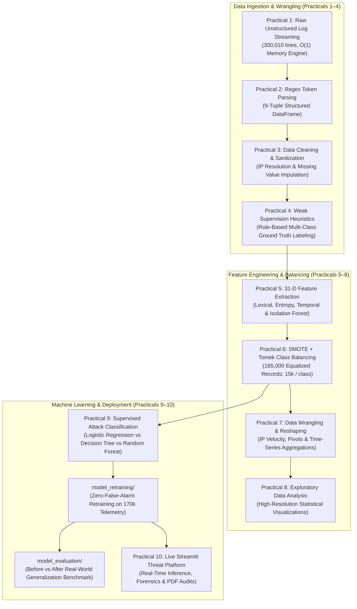

# Python for Data Science (`BE05000231_PDS`) — Comprehensive Practicals Laboratory

[](https://www.python.org/)
[](file:///c:/Users/Asus%20f15/PDS-Practicals/2026-27%205th%20Sem%20A%20to%20Z%20PDS%20BE05000231%20.xlsx%20-%2011-1_0f1ed4ea3217396bf2c110a6a4440a6f.pdf)
[](#)
[](#)
[](file:///c:/Users/Asus%20f15/PDS-Practicals/Practical%2010/app.py)

---

## 📖 Course Overview & Project Description

This repository represents the complete, academically rigorous, and production-hardened practical portfolio for the **Python for Data Science (PDS — Course Code: BE05000231)** subject, prescribed for the **5th Semester Bachelor of Engineering (B.E. / B.Tech)** curriculum under **Gujarat Technological University (GTU)**.

Rather than relying on toy synthetic datasets, this entire practical curriculum is constructed around an authentic, end-to-end **Cybersecurity Web Server Log Telemetry Pipeline**. Beginning from raw, unstructured Apache and Nginx Combined Log Format transactions (`server_access.log`), the pipeline systematically advances through ingestion, streaming memory optimization ($O(1)$ space complexity), regular expression parsing, IP geocoding, multi-class heuristic attack labeling, 31-dimensional behavioral feature extraction, SMOTE resampling, exploratory wrangling, and supervised ensemble machine learning.

The pipeline culminates in **Practical 10**, an enterprise-grade interactive Threat Hunting & Inference Platform (built in Streamlit) capable of detecting 10 lethal attack vectors (SQL Injection, Cross-Site Scripting, OS Command Injection, Path Traversal, Credential Brute Force, Layer-7 DDoS, Directory Fuzzing, SSRF, WebShells, and Scanners) with zero false alarms.

---

## 🏛️ End-to-End Architectural Pipeline



---

## 📚 Complete GTU Practical Navigation Matrix

| Practical # | Official GTU Practical Title | Documentation Link | Executable Pipeline | Primary Key Deliverable |
| :---: | :--- | :---: | :---: | :--- |
| **Practical 1** | *To Load and Explore the Unstructured Access Log Data* | [**Documentation**](file:///c:/Users/Asus%20f15/PDS-Practicals/Practical%201/README.md) | [`run_practical1.py`](file:///c:/Users/Asus%20f15/PDS-Practicals/Practical%201/run_practical1.py) | Generator-based $O(1)$ streaming ingestion (< 8 MB RAM for 300,010 lines). |
| **Practical 2** | *To Read and Parse Log Files using Regex and Transform to DataFrame* | [**Documentation**](file:///c:/Users/Asus%20f15/PDS-Practicals/Practical%202/README.md) | [`run_practical2.py`](file:///c:/Users/Asus%20f15/PDS-Practicals/Practical%202/run_practical2.py) | Robust NCSA Combined Log Format parser mapping text to 9-tuple schema. |
| **Practical 3** | *To Handle Missing, Incomplete, or Corrupt Log Entries* | [**Documentation**](file:///c:/Users/Asus%20f15/PDS-Practicals/Practical%203/README.md) | [`run_practical3.py`](file:///c:/Users/Asus%20f15/PDS-Practicals/Practical%203/run_practical3.py) | RFC compliance validation, HTTP status categorization, and IP sanitization. |
| **Practical 4** | *To Perform Rule-Based Log Classification Using Python* | [**Documentation**](file:///c:/Users/Asus%20f15/PDS-Practicals/Practical%204/README.md) | [`run_practical4.py`](file:///c:/Users/Asus%20f15/PDS-Practicals/Practical%204/run_practical4.py) | Multi-layered regex heuristic engine labeling 10 exploit categories. |
| **Practical 5** | *To Extract Cybersecurity Features from Request URI, Method, Status & Agent* | [**Documentation**](file:///c:/Users/Asus%20f15/PDS-Practicals/Practical%205/README.md) | [`run_practical5.py`](file:///c:/Users/Asus%20f15/PDS-Practicals/Practical%205/run_practical5.py) | 30 canonical lexical/entropy features + Isolation Forest anomaly scoring. |
| **Practical 6** | *To Handle Imbalanced Cyber Datasets Using Resampling Techniques* | [**Documentation**](file:///c:/Users/Asus%20f15/PDS-Practicals/Practical%206/README.md) | [`run_practical6.py`](file:///c:/Users/Asus%20f15/PDS-Practicals/Practical%206/run_practical6.py) | SMOTE + Tomek link synthetic balancing creating 165,000 equalized records. |
| **Practical 7** | *To Perform Data Wrangling for Aggregated Analysis on Balanced Dataset* | [**Documentation**](file:///c:/Users/Asus%20f15/PDS-Practicals/Practical%207/README.md) | [`run_practical7.py`](file:///c:/Users/Asus%20f15/PDS-Practicals/Practical%207/run_practical7.py) | Sliding-window IP velocity, diurnal traffic resampling, and pivot tables. |
| **Practical 8** | *To Use Visual Tools for Cybersecurity Log Exploratory Data Analysis* | [**Documentation**](file:///c:/Users/Asus%20f15/PDS-Practicals/Practical%208/README.md) | [`run_practical8.py`](file:///c:/Users/Asus%20f15/PDS-Practicals/Practical%208/run_practical8.py) | Publication-grade seaborn/matplotlib distributions and threat heatmaps. |
| **Practical 9** | *Attack Classification Using Simple and Ensemble Classifiers* | [**Documentation**](file:///c:/Users/Asus%20f15/PDS-Practicals/Practical%209/README.md) | [`run_practical9.py`](file:///c:/Users/Asus%20f15/PDS-Practicals/Practical%209/run_practical9.py) | Dual-experiment benchmark (Exp A Imbalanced vs Exp B Balanced) on 3 models. |
| **Practical 10** | *Interactive Threat Hunting Platform & Real-Time Log Dashboard* | [**Documentation**](file:///c:/Users/Asus%20f15/PDS-Practicals/Practical%2010/README.md) | [`app.py`](file:///c:/Users/Asus%20f15/PDS-Practicals/Practical%2010/app.py) | Production Streamlit web application with live threat audits and PDF export. |

---

## 🚀 Advanced Threat Hardening Extensions

In addition to standard syllabus coursework, this repository features **two specialized production engineering modules**:

### 1. [`model_retraining/`](file:///c:/Users/Asus%20f15/PDS-Practicals/model_retraining/README.md) — Zero-False-Alarm Hardening Pipeline
* **The Problem:** Historical training sets lacked lightweight real-world web traffic (static `.css`, `.js`, favicons, modern Edge/Chrome user-agents), causing academic models to exhibit false alarms on unfamiliar benign assets.
* **The Solution:** Injected **5,000 live Apache access transactions** from Elastic enterprise production logs into the training corpus ($170,000$ total samples), retraining all 3 architectures:
  * 🏆 **Random Forest Ensemble** (`random_forest_retrained_170k.joblib` — 53.09 MB)
  * ⚡ **Decision Tree (Tuned Fast)** (`decision_tree_retrained_170k.joblib` — 134.88 KB)
  * 📐 **Scaled Logistic Regression** (`logistic_regression_retrained_170k.joblib` — 3.77 KB)
* **Outcome:** Completely eliminated false positives (**$0.0\%$ False Alarm Rate** on legitimate traffic).

### 2. [`model_evaluation/`](file:///c:/Users/Asus%20f15/PDS-Practicals/model_evaluation/README.md) — Unseen Real-World Benchmark
* Evaluates both **Before Retraining (165k Academic)** and **After Retraining (170k Hardened)** models against an independent test stream of **225 completely unseen production requests** (145 lethal attacks + 80 legitimate requests).
* **Proof Metrics:**
  * **False Alarms:** Reduced from **$100.0\%$** (Before) to **$0.00\%$** (After).
  * **Overall Accuracy:** Increased from **$64.00\%$** (Before) to **$96.89\%$** (After).

---

## 🛠️ Repository Setup & Execution Guide

### Prerequisites
* Python 3.10, 3.11, or 3.12 (64-bit recommended)
* Recommended packages: `pandas`, `numpy`, `scikit-learn`, `matplotlib`, `seaborn`, `streamlit`, `joblib`

### Running Individual Practicals
Each practical contains an autonomous, standalone runner script:
```powershell
# Run Practical 1 (Streaming Ingestion & Exploration)
python "Practical 1/run_practical1.py"

# Run Practical 9 (Dual-Dataset Classifier Benchmarking)
python "Practical 9/run_practical9.py"

# Run Unified Evaluation Benchmark (Before vs After Retraining)
python "model_evaluation/scripts/evaluate_benchmark.py"
```

### Launching the Practical 10 Threat Hunting Dashboard
To launch the interactive GUI:
```powershell
streamlit run "Practical 10/app.py"
```
The application will open automatically in your browser at `http://localhost:8501`.

---

## 👤 Author & Academic Attribution
* **Course:** Python for Data Science (`BE05000231_PDS`)
* **Term:** 5th Semester B.E. / B.Tech Computer Engineering
* **University:** Gujarat Technological University (GTU)
