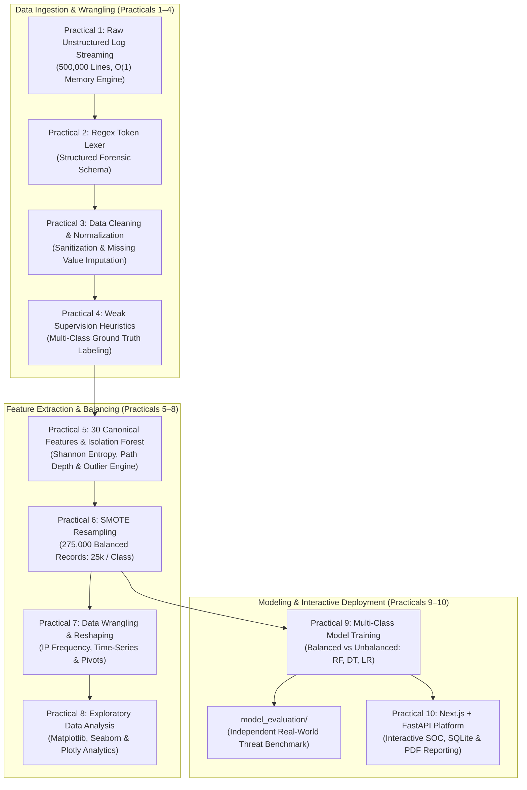

# Python for Data Science (`BE05000231_PDS`) — Laboratory Practicals Portfolio

**University:** Gujarat Technological University (GTU-GSET)  
**Course Code:** BE05000231 (Python for Data Science - PDS)  
**Academic Term:** 2023–24  
**Domain:** Cybersecurity Web Server Telemetry, Behavioral Feature Engineering & Machine Learning Threat Intelligence  

---

## 1. Course & Laboratory Overview

This repository houses the complete, academically rigorous practical portfolio for the **Python for Data Science** laboratory. The curriculum is built entirely upon an authentic 500,000-line web server access log dataset (`server_access.log`). Starting from raw, unstructured Apache and Nginx Combined Log Format transactions, the pipeline systematically progresses across:
1. Low-memory streaming data ingestion ($O(1)$ memory complexity)
2. High-speed regular expression token parsing and DataFrame transformation
3. RFC-compliant data normalization, URI decoding, and missing value handling
4. Heuristic labeling establishing authoritative multi-class ground truth
5. 30-dimensional canonical feature engineering and unsupervised Isolation Forest anomaly scoring
6. Hybrid resampling (SMOTE oversampling on rare classes + stratified undersampling) yielding 275,000 equalized records across 11 classes
7. Aggregated wrangling, IP velocity analysis, and time-series resampling
8. Statistical visual exploratory data analysis (EDA)
9. Supervised multi-class attack classification (Random Forest, Decision Tree, Logistic Regression)
10. Interactive SOC Deployment Platform: High-performance FastAPI ML Backend and minimalist Next.js 16 dashboard with SQLite persistence and automated executive PDF audit reports.

---

## 2. End-to-End Architectural Pipeline



---

## 3. GTU Practicals Navigation Matrix

| Practical # | Official Practical Title | Code Location | Key Deliverables & Achievements |
| :---: | :--- | :---: | :--- |
| **Practical 1** | *To Load and Explore the Unstructured Access Log Data* | [Practical 1](Practical%201/README.md) | Generator-based $O(1)$ streaming log ingestion processing 500,000 lines in $<8$ MB RAM. |
| **Practical 2** | *To Read and Parse Log Files using Regex and Transform to DataFrame* | [Practical 2](Practical%202/README.md) | NCSA Combined Log Format parser decomposing lines into typed tabular schemas. |
| **Practical 3** | *To Handle Missing, Incomplete, or Corrupt Log Entries* | [Practical 3](Practical%203/README.md) | URL percent-decoding, RFC compliance filtering, and missing header imputation. |
| **Practical 4** | *To Perform Rule-Based Log Classification Using Python* | [Practical 4](Practical%204/README.md) | Multi-vector heuristic engine establishing ground truth labels across 11 classes. |
| **Practical 5** | *To Extract Cybersecurity Features from Request URI, Method, Status & Agent* | [Practical 5](Practical%205/README.md) | 30 canonical lexical/entropy features + physical Isolation Forest anomaly engine. |
| **Practical 6** | *To Handle Imbalanced Cyber Datasets Using Resampling Techniques* | [Practical 6](Practical%206/README.md) | Hybrid resampling (SMOTE oversampling + stratified undersampling) equalizing 11 classes to 275,000 records without data leakage. |
| **Practical 7** | *To do the Data Wrangling for Aggregated Analysis on Balanced Dataset* | [Practical 7](Practical%207/README.md) | GroupBy IP frequencies, hourly time-series resampling, and cross-tabulation pivots. |
| **Practical 8** | *To Use Visual Tools for Data Visualization and EDA* | [Practical 8](Practical%208/README.md) | Publication-grade static and interactive EDA visualizations (heatmaps, distributions). |
| **Practical 9** | *To Train Machine Learning Models for Multi-Class Attack Detection* | [Practical 9](Practical%209/README.md) | Trained Random Forest (98.72%), Decision Tree (99.01%), and Logistic Regression (94.95%). |
| **Practical 10** | *Interactive Threat Intelligence & Model Deployment Platform* | [Practical 10](Practical%2010/README.md) | Next.js 16 SOC Dashboard, FastAPI REST Backend, SQLite audit persistence, PDF export. |

---

## 4. Machine Learning Model Scorecard (Practical 9 & Evaluation)

All models evaluated on the locked 100,000 test partition:

| Model Architecture | Training Partition | Test Accuracy | Macro Recall | Macro F1 | Deployment Role |
| :--- | :---: | :---: | :---: | :---: | :--- |
| **Random Forest (Tuned)** | Balanced (275k) | **98.72%** | **99.62%** | **0.9881** | **Overall Production Champion** |
| **Decision Tree (Tuned)** | Balanced (275k) | **99.01%** | **99.58%** | **0.9908** | **Ultra-Fast Line-Rate Model (0.01s)** |
| **Random Forest (Base)** | Balanced (275k) | 97.07% | 99.20% | 0.9720 | Default Ensemble Baseline |
| **Decision Tree (Base)** | Balanced (275k) | 97.32% | 99.14% | 0.9737 | Default Decision Tree Baseline |
| **Logistic Regression** | Balanced (275k) | 94.95% | 98.02% | 0.9503 | Linear Multinomial Baseline |

---

## 5. Technology Stack

- **Core Analytics & ML:** Python 3.12, NumPy, Pandas, Scikit-Learn, Joblib, Imbalanced-Learn (SMOTE)
- **Data Visualizations:** Matplotlib, Seaborn, Plotly
- **Backend Architecture:** FastAPI, Uvicorn, SQLite3, fpdf2 (Executive PDF Generation)
- **Frontend Architecture:** Next.js 16 (App Router), TypeScript, Tailwind CSS, Lucide Icons (Zero Emojis)

---

## 6. Getting Started

### 1. Environment Setup
```bash
python -m venv venv
venv\Scripts\activate   # Windows
pip install -r requirements.txt
```

### 2. Launching SentinelSOC (Practical 10)
```bash
python "Practical 10/run_practical10.py"
```
Access the services at:
- **Web UI:** http://localhost:3000
- **API Server:** http://127.0.0.1:8000
- **Swagger Docs:** http://127.0.0.1:8000/docs
