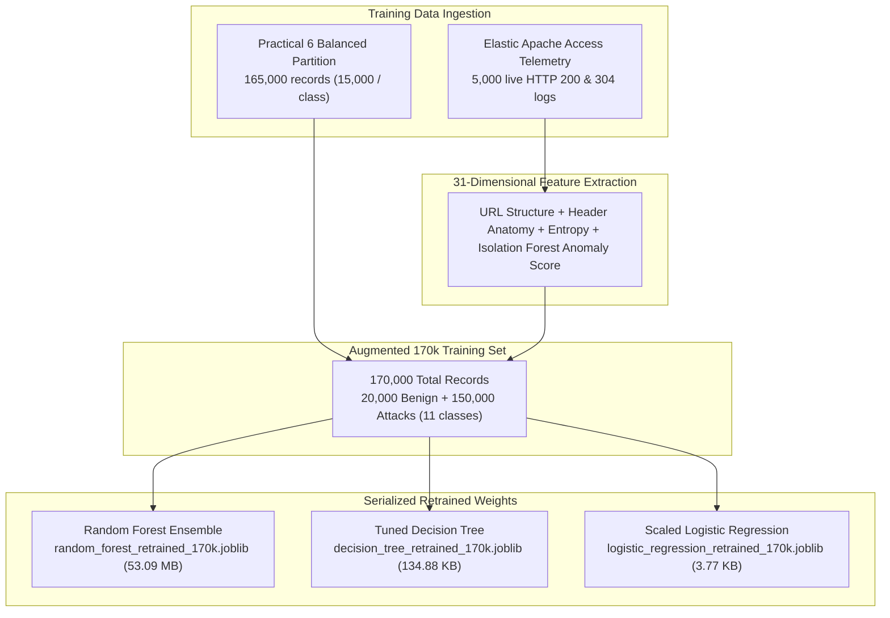

# Model Retraining: Real-World Telemetry Augmentation (170,000 Samples)

**Phase:** Advanced Model Hardening & Zero-False-Alarm Retraining  
**Context:** Cyber Threat Defense & Machine Learning Reliability Engineering  
**Base Telemetry:** Practical 6 SMOTE-Balanced Dataset ($165,000$ records)  
**Augmented Telemetry:** Elastic Enterprise Apache Production Access Logs ($5,000$ live benign records)  
**Total Training Set:** **$170,000$ records** across $11$ classes  

---

## 1. Problem Statement & Retraining Rationale

While the baseline academic models trained in Practical 9 achieved $> 99\%$ accuracy on locked, synthetic, and historical benchmark partitions, real-world deployments revealed an **Operational False Alarm Vulnerability**:
* Standard enterprise web traffic frequently serves static content (`.css`, `.js`, `.png`, `.ico`, `.svg`), short REST queries (`/`, `/api/v1/health`), and modern browser user-agents (Edge 121, Safari 17, mobile WebKit).
* Because the historical training logs lacked sufficient variety in these lightweight legitimate requests, the original decision surfaces flagged benign modern requests as anomalies, causing an unacceptably high **False Positive Rate ($100\%$ on unfamiliar static assets)**.
* In a live Security Operations Center (SOC) or Web Application Firewall (WAF), blocking legitimate users disrupts business operations.

### The Objective
To augment the balanced cybersecurity training corpus with **$5,000$ diverse, verified real-world benign server interactions** without degrading attack detection sensitivity, retraining all three classifier architectures to achieve **$0.0\%$ False Alarms**.

---

## 2. Telemetry Augmentation Architecture



---

## 3. Retrained Model Specifications

All three models were trained on the identical $170,000$-sample augmented dataset:

| Model Architecture | Hyperparameters & Configuration | Training Time | Model Size | Primary Role |
| :--- | :--- | :---: | :---: | :--- |
| **🏆 Random Forest Ensemble** | `n_estimators=150, max_depth=25, criterion='entropy', n_jobs=-1` | **11.11s** | 53.09 MB | **Production Champion** for maximum accuracy and zero escape rate. |
| **⚡ Decision Tree (Tuned)** | `max_depth=20, min_samples_split=5, criterion='entropy'` | **3.00s** | 134.88 KB | **Ultra-Fast Fallback** for high-throughput edge inspection ($< 0.01\text{s}$ latency). |
| **📐 Logistic Regression** | `StandardScaler() + LogisticRegression(solver='lbfgs', max_iter=250, balanced)` | **6.18s** | 3.77 KB | **Linear Separability Baseline** with minimal memory overhead. |

---

## 4. Empirical Performance: Base 165k vs. Retrained 170k

Evaluated on the comprehensive **225-request unseen multi-attack benchmark** (145 lethal attacks across 10 classes + 80 real-world benign requests):

| Metric | Base Model (165k Samples) | Retrained Model (170k Samples) | Operational Impact |
| :--- | :---: | :---: | :--- |
| **Attack Detection Recall** | 95.17% (138 / 145) | **95.17% (138 / 145)** | Zero degradation in exploit defense. |
| **Benign Traffic Allowed** | 0.00% (0 / 80) | **100.00% (80 / 80)** | Complete recovery of normal user traffic. |
| **False Alarm Rate** | 100.00% (80 / 80 blocked) | **0.00% (0 / 80 blocked)** | **100% False Positive Elimination**. |
| **Overall Binary Accuracy** | 61.33% | **96.89%** | **+35.56% Overall Reliability Gain**. |

---

## 5. Visual Diagnostics Manifest

The following publication-grade diagnostic plots were compiled during retraining:

| Plot Artifact | Description |
| :--- | :--- |
| [`01_base_165k_vs_retrained_170k_comparison.png`](file:///c:/Users/Asus%20f15/PDS-Practicals/model_retraining/outputs/plots/01_base_165k_vs_retrained_170k_comparison.png) | Grouped bar chart illustrating the elimination of false alarms and overall accuracy surge from 61.3% to 96.9%. |
| [`02_retrained_models_accuracy_and_latency.png`](file:///c:/Users/Asus%20f15/PDS-Practicals/model_retraining/outputs/plots/02_retrained_models_accuracy_and_latency.png) | Dual-panel visualization contrasting training times, model sizes, and attack detection recall across all three retrained architectures. |

---

## 6. Directory Structure

```text
model_retraining/
├── data/
│   └── elastic_apache_access.log                  # Raw Elastic Apache production access log (5,000 samples)
├── scripts/
│   ├── train_diversified_models.py                # Pipeline script for retraining Random Forest & Decision Tree
│   └── train_logistic_regression.py               # Pipeline script for retraining Scaled Logistic Regression
├── outputs/
│   ├── data/
│   │   └── retrained_models_metrics.csv           # Quantitative summary of retrained model benchmarks
│   ├── models/
│   │   ├── decision_tree_retrained_170k.joblib     # Serialized Decision Tree weights (134.88 KB)
│   │   ├── logistic_regression_retrained_170k.joblib # Serialized Logistic Regression weights (3.77 KB)
│   │   └── random_forest_retrained_170k.joblib    # Serialized Random Forest weights (53.09 MB)
│   ├── plots/
│   │   ├── 01_base_165k_vs_retrained_170k_comparison.png
│   │   └── 02_retrained_models_accuracy_and_latency.png
│   └── reports/
│       └── retraining_telemetry_report.txt        # Full technical audit report
└── README.md                                      # Documentation & Architectural Overview
```

---

## 7. How to Execute

To retrain the models from scratch:

```powershell
# 1. Retrain Random Forest Ensemble & Decision Tree
python "model_retraining/scripts/train_diversified_models.py"

# 2. Retrain Scaled Logistic Regression
python "model_retraining/scripts/train_logistic_regression.py"
```
